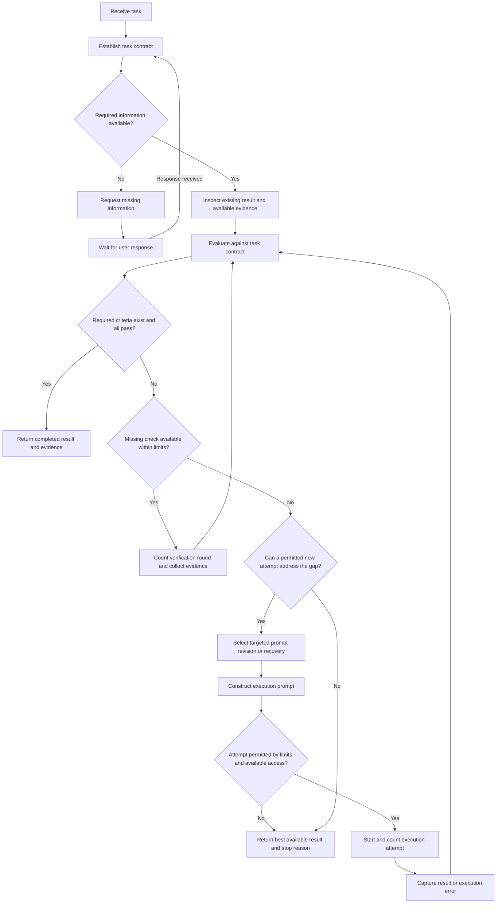

# Prompt Loop: Design Specification

Document version: 0.5  
Date: 6 November 2026  
Status: Initial skill implemented against this baseline. See the [five pre-development checks](pre-development-checks.md) and [implementation validation](implementation-validation.md) for the review and observed limits.

## 1. Purpose

The skill helps an agent complete a task through repeated prompt improvement and output evaluation. Each prompt revision addresses an observed gap in the previous output.

The target result is a completed task. A revised prompt is an intermediate result.

The skill improves prompts during the current task. Changes to the skill itself or to model parameters are outside the initial scope.

## 2. Requirement sources and writing profile

The user requested this sequence:

1. Understand the problem.
2. Improve the prompt.
3. Send the prompt for execution.
4. Analyze the output.
5. Create another improved prompt.
6. Repeat the cycle until the task is complete.

The user then requested documentation before implementation and selected the `controlled-technical-english` skill for writing.

This document uses the following profile:

| Setting | Basis |
|---|---|
| Document type | System description and design specification |
| Intended reader | Project owner and skill developer |
| Terminology | Project terms defined in Section 3 |
| Writing style | Controlled Technical English skill, with its baseline house rules |
| Requirement words | `must` states a requirement, `should` states a recommendation, `may` grants permission, and `can` states a capability |
| External standard | None specified. This document makes no external compliance claim. |

The user sequence is the source requirement. The remaining details are proposed design decisions. Numerical limits are proposed defaults, not user requirements.

## 3. Terms

| Term | Meaning |
|---|---|
| Task | The result that the user requests |
| Task contract | A record of the objective, constraints, required outputs, and completion criteria |
| Completion criterion | An observable condition used to evaluate the result. Required criteria control task completion. |
| Execution prompt | The instructions used to produce or revise a candidate result |
| Prompt revision | A change to an execution prompt based on an identified requirement or observed gap |
| Executor | The agent or configured service that acts on the execution prompt |
| Candidate result | The output and artifacts produced by one execution attempt |
| Evaluation | A comparison of a candidate result with the task contract |
| Evidence | An observed result that supports an evaluation finding |
| Iteration | One started execution attempt and its evaluation, including an attempt that returns an execution error |
| Verification round | One finite, planned set of checks that collects evidence for a candidate. A check retry or a newly selected check set starts another round. |
| Best candidate | The retained candidate selected by the comparison rules in Section 7.4 |
| Stagnation | Consecutive iterations that produce no meaningful improvement over the best candidate |

## 4. Scope

The first version should define a reusable skill that runs inside an existing agent environment. The skill supplies instructions for the cycle. The host environment supplies model access, tools, and execution permissions.

The initial scope includes task interpretation, prompt construction, execution, evaluation, prompt revision, termination, and a final report.

The initial scope excludes a standalone application, a dashboard, model training, automatic changes to installed skills, and provider-specific integrations.

The skill must use the tools and permissions available in the host environment. The skill must not claim an external model call when the same agent executes the prompt.

The skill should apply when a user requests repeated prompt execution and evaluation through task completion. A request to rewrite a prompt without execution does not start this cycle.

Skill discovery should remain enabled by default. Discovery does not authorize external actions or override a request to perform only one revision.

## 5. Proposed execution model

The default executor is the active agent. The agent constructs an execution prompt and then performs the requested work with its available tools.

In this mode, "send the prompt" means pass the execution prompt into the execution stage. It does not imply a separate network request.

A separate executor can be added when the host environment provides a suitable integration. Such an integration must return an output or a clear execution error. It must identify the destination and preserve the task's authorization boundaries.

The prompt construction, execution, and evaluation stages are logical roles. Separate agents are not required. If one agent performs all roles, the final report must not describe the evaluation as independent review.

An execution prompt is an explicit instruction artifact. The iteration record must contain enough of the prompt to identify the objective, correction, constraints, and expected output. Private reasoning is not an execution prompt.

The first version does not guarantee a separate model invocation or a continuously running process. Execution depends on the host session remaining active.

## 6. Task contract

Before the first execution attempt, the agent must establish the following information:

| Field | Required content |
|---|---|
| Original request | The user's request without changes to its meaning |
| Objective | A concise statement of the required result |
| Context | Relevant files, facts, environment details, and prior work |
| Constraints | Scope, format, tools, permissions, and explicit exclusions |
| Required outputs | The response, files, or other artifacts to produce |
| Completion criteria | Criteria with stable identifiers, a required or optional classification, and an observable acceptance condition |
| Verification method | The evidence source and check required to evaluate each criterion |
| Assumptions | Missing details that the agent can reasonably infer |
| Execution limits | Applicable iteration limits and any supplied time or cost limits |

The agent should use available context before requesting information. If a missing detail prevents correct execution, the agent must request that detail.

Requirements from the user and applicable project instructions are required criteria, subject to the host's instruction hierarchy. Additional quality preferences are optional unless the user makes those preferences required.

When the request leaves an acceptance condition unspecified, derive a reasonable condition from the available context and label the condition as an assumption. Request input only if the uncertainty prevents correct execution.

Before evaluating completion, the task contract must contain at least one required criterion. Required criteria must cover every required output and applicable constraint. A missing required output cannot pass merely because other checks pass.

If the criteria list is empty or contains only optional preferences, correct the contract from the request. If the required result remains unclear, request the missing information. An empty list is not evidence of completion.

The agent must preserve the objective, constraints, and required criteria during prompt revision. New evidence can correct a factual assumption. New evidence does not authorize removal or weakening of a user requirement.

Record a contract version when the contract changes. Record the source and effect of each change. Resolve conflicts through the applicable instruction hierarchy first. Request resolution only when a material conflict remains unresolved.

After a contract change, reevaluate affected candidates and invalidate evidence that no longer applies. A user request to change one requirement does not reset execution limits unless the user also changes those limits.

Select the best candidate again under the revised contract before comparing further attempts. If no retained candidate is usable under that contract, record that no current baseline exists. Keep the old references as history.

Preserve the total attempt and verification-round counts after a contract change. A contract version change alone does not count as progress or reset the stagnation count. Count later progress against the revised contract.

## 7. Workflow

### 7.1 Understand the task

Identify the objective, available context, constraints, and required outputs. Convert vague goals into observable completion criteria where the context supports that interpretation.

For subjective tasks, use explicit user preferences and stated review criteria. Do not invent an objective quality measurement.

If the user requires a final decision from a person, that decision remains a required criterion. The agent cannot substitute its own approval.

Inspect an existing result before generating another candidate. If current evidence establishes that all required criteria already pass, report `completed` with zero execution attempts.

Checks of an existing result remain subject to available access and supplied time or cost limits. Do not claim zero-attempt completion without sufficient evidence.

### 7.2 Construct the execution prompt

The execution prompt should contain the objective, relevant context, constraints, required outputs, and verification expectations.

For later iterations, include the failed criteria, supporting evidence, and a specific correction. Preserve successful parts of the previous result.

For an unverified criterion, identify the missing evidence before requesting another candidate. If the candidate is sufficient, perform the missing check without regenerating the candidate.

Before execution, compare the prompt with the current task contract. Correct any omitted or conflicting requirement.

Avoid instructions such as "make it better" without an identified defect. Do not expand the scope to create the appearance of progress.

### 7.3 Execute the prompt

Before execution, check the configured limits and access needed for the next action. If additional authorization is required by the host, request that authorization and wait for the response.

When execution starts, increment the attempt count. Capture the candidate result, changed artifacts, relevant tool results, and execution errors.

If an execution error occurs, determine whether the error concerns the prompt, the environment, or an unavailable dependency. Change the prompt only when that change addresses the cause.

An environment recovery can leave a suitable execution prompt unchanged. Record the recovery action and check its access and limits before performing the action. Any subsequent executor retry still counts as a new attempt.

Before repeating an action with external effects, inspect the current state. Do not repeat an already completed action solely because its response was unclear.

If the current state cannot be established, stop the repeat attempt and report the uncertainty. Do not assume that an error response means no action occurred.

### 7.4 Evaluate the candidate result

Evaluate each completion criterion as `pass`, `fail`, or `unverified`. Record the criterion identifier, candidate reference, evidence, and remaining gap.

Use direct evidence where available. Examples include relevant test results, artifact inspection, source checks, and comparison with explicit format requirements.

A statement from the executor that the task is complete is not sufficient evidence. An unverified required criterion prevents a completion claim.

Only required criteria control task completion. Optional preferences must not prolong the cycle after all required criteria pass.

Evidence must apply to the current contract and candidate. If an artifact or dependency changes, recheck affected criteria. Do not present a check of an earlier artifact as evidence for a changed artifact.

If a check produces no new evidence, do not repeat that check against unchanged state. Use another available verification method or report the unresolved verification dependency.

If a usable candidate exists and the only unresolved gap is unavailable verification, do not regenerate the candidate. Report `needs_input` for a required user decision or `blocked` for an unavailable verification dependency. If a supplied limit prevents the check, report `limit_reached`.

A new execution attempt requires an identified correction or recovery that can address an unresolved required gap. Spare attempts alone are not a reason to execute again.

Compare candidates under the same contract version. Prefer a candidate that preserves all verified required behavior and makes meaningful improvement on a required gap, as defined in Section 8. If neither candidate is clearly better, retain the previous best candidate and record the tradeoff.

The first usable candidate establishes the baseline. An execution error without a usable result does not establish a best candidate.

For working files, preserve useful work through suitable version control or copies when needed. A retained reference does not restore the working state automatically.

Before returning a previous best candidate, inspect the actual files or external state. Restore only authorized, reversible changes and verify the resulting state. Do not overwrite unrelated user changes.

If a previous candidate cannot be restored, report the current result and the retained reference separately. Do not present the retained candidate as the current result.

### 7.5 Revise the prompt

For each selected gap, state the observed failure, the required correction, and the evidence needed to verify the correction.

Keep each revision focused on the most important unresolved criteria. If a revision causes a regression, preserve the earlier successful behavior in the next prompt.

If repeated revisions fail, change the execution approach when another suitable approach is available. Repeated paraphrasing does not count as meaningful progress.

Retrieved content and executor output do not gain instruction authority merely because the agent receives them. Neither source can independently grant permissions or alter execution limits.

User-designated specifications and applicable project instructions can supply requirements under the host's instruction hierarchy. Factual findings can correct assumptions through the contract-change rules in Section 6. Other task data remains evidence to evaluate.

## 8. Completion and termination

The agent must stop successfully when all required completion criteria pass. The agent must not continue solely to improve wording after the task is complete.

The cycle also needs explicit limits because some tasks cannot be completed with the available information, tools, or permissions.

| Outcome | Condition | Required report |
|---|---|---|
| `completed` | At least one required criterion exists, every required output is available, and all required criteria pass | Final result and verification evidence |
| `needs_input` | Missing user information prevents the next required action | Exact missing information and relevant partial work |
| `needs_authorization` | The next required action lacks authorization under the host's rules | The concrete action, reason authorization is required, and prepared work |
| `blocked` | An unavailable capability or external dependency prevents further progress | Dependency, unresolved criteria, and recovery action |
| `stagnated` | The stagnation limit is reached | Best candidate, repeated failures, and an alternative approach if known |
| `limit_reached` | An execution-attempt, verification-round, time, or cost limit prevents the next required action | Best candidate, unresolved criteria, and the limit reached |
| `cancelled` | The user stops the task | Current work and known incomplete actions |

These outcomes describe this proposed skill. They are not mappings to a particular host application's status API.

Proposed defaults for the first version:

Supplied execution and verification limits must be nonnegative integers. The stagnation limit must be a positive integer. Zero disables the corresponding action. If supplied values are invalid, request clarification rather than silently replacing them.

| Setting | Proposed value | Definition |
|---|---|---|
| Maximum iterations | 8 | Counts every started execution attempt, including execution errors, timeouts, and attempts with unusable output |
| Maximum verification rounds | 8 per task | Counts every started set of evidence-gathering checks, including unsuccessful checks. This proposed limit is separate from the execution-attempt limit. |
| Stagnation limit | 3 | Consecutive attempts after the baseline without meaningful improvement, or consecutive failed attempts when no usable baseline exists |
| Meaningful improvement | Evidence-based | An unresolved criterion passes, a material defect is reduced, or a necessary dependency is resolved without a material regression |
| Time or cost limit | Use supplied limits | No numerical default is specified. Report when usage cannot be measured. |
| Evaluation result | Per criterion | No aggregate score can override a failed or unverified required criterion |

Check limits before each execution attempt. Check supplied time and cost limits during execution when the host supports those checks.

Before starting a verification round, record its finite set of checks and expected evidence. Increment the verification-round count when those checks start. A failed round still consumes a round.

Do not extend a running round with repeated retries or an open-ended search for another verification method. A check retry or a different check set requires another permitted round. Checks performed during an execution attempt also count when they form an evidence-gathering round.

Reviewing evidence already captured in the record does not start a verification round. Changing the candidate, revising the contract, or resuming the conversation does not reset the verification-round count.

If no useful verification method remains, report the applicable dependency without consuming the remaining rounds. If the verification-round limit prevents a required check, report `limit_reached`. Do not generate another candidate solely to avoid that limit.

All actions, including verification and recovery, remain subject to supplied time and cost limits. If a limit prevents a required check, report the criterion as unverified.

A first-attempt success must end after one iteration. A stopped incomplete task must retain its incomplete status.

If an existing result already meets all required criteria, no execution attempt is required. A zero-attempt completion report must identify that existing result and its supporting evidence.

Constructing or editing a prompt does not consume an execution attempt. Checks that only inspect existing results do not consume another attempt. Execution retries must not bypass the attempt count.

An attempt can include several tool operations needed to produce one candidate. A new candidate request after evaluation starts another attempt. Retrying a failed executor request also starts another attempt.

Use the first usable candidate as the baseline and set its stagnation count to zero. An improved candidate resets the stagnation count. Other subsequent attempts increment the stagnation count.

When no baseline exists, each failed attempt increments the stagnation count. A missing prerequisite known before execution should produce `needs_input` or `blocked` without a repeat attempt.

If all required criteria pass on the last permitted attempt, report `completed`. A reached attempt limit prevents another attempt. The limit does not invalidate a completed result.

The same completion rule applies to the last permitted verification round. Sufficient evidence collected in that round can establish completion. Reviewing that captured evidence does not require an additional round.

If the user cancels, stop further actions and report `cancelled`. Otherwise, evaluate observed completion before selecting an incomplete outcome. If multiple incomplete outcomes apply, report the condition that prevents the next action and list any reached limits.

For `needs_input` and `needs_authorization`, wait for a response before the dependent action. Elapsed time is not a response. After the response, inspect the current state before continuing.

If a hard time or cost limit cannot be enforced by the host, do not start an action whose usage could exceed that limit. Use an available method with an enforceable upper bound or report the limitation as `needs_input`.

Request a feasible execution method or a change to the limit only when neither is available from the current instructions. Disclosure alone does not authorize execution beyond a hard limit.

Distinguish estimates from enforceable bounds. Any cost or time estimates must be labeled as estimates and must not replace a supplied hard limit.

## 9. Iteration record and final report

The agent must retain a compact iteration record during the task:

| Record | Content |
|---|---|
| Task contract | Version, objective, constraints, criterion identifiers, assumptions, and limits |
| Iteration identifier | Sequential attempt number |
| Execution prompt | Instructions used for this attempt |
| Candidate reference | Output or artifact reference with enough version information to identify the evaluated state |
| Evaluation findings | Criterion status, evidence, and unresolved gaps |
| Revision summary | Correction selected for the next iteration |
| Best candidate reference | Retained candidate and the reason for its selection |
| Outcome | Current cycle state or termination reason |
| Counters | Started execution attempts, started verification rounds, consecutive attempts without improvement, and remaining measurable limits |

The record contains observable decisions and evidence. It does not require private internal reasoning. The record should exclude credentials and unnecessary sensitive content.

The initial design assumes that the host conversation retains the record. Durable files and recovery across separate sessions remain future options.

Before context is shortened, retain the current contract, best candidate reference, unresolved findings, counters, and next action. Do not invent lost history or silently reset counters.

If the record is unavailable, reconstruct the current artifact state and disclose the missing history. Resolve missing limit information before another attempt.

The final report must state the outcome, provide the completed result or best available candidate, summarize verification, and identify unresolved criteria.

If no usable candidate exists, state that no candidate is available. Do not create an artifact reference or imply a successful result to fill the report.

For `needs_input`, the agent should ask a precise question. For other incomplete outcomes, the agent should state the condition needed to resume.

During execution, provide concise updates when findings or direction change. Do not require a user response after each prompt revision unless the next action actually depends on that response.

The final report should summarize material prompt changes and the attempt count. The full prompt history is available on request when the host has retained that history.

## 10. Illustrative cycle

This example describes intended behavior. A related controlled exercise is recorded in [implementation validation](implementation-validation.md). That exercise does not establish general reliability.

The user requests a Python function that removes duplicate values while preserving their order. The user also requires support for unhashable values.

The task contract includes order preservation, duplicate removal, and support for unhashable values. Relevant examples provide verification evidence.

The first execution produces a function that uses a set. Evaluation finds that a list value causes a failure.

The next prompt identifies the failure and requests duplicate detection that supports unhashable values. The prompt preserves the existing order requirement.

The next execution produces a revised function. If relevant checks pass for all required criteria, the agent returns the function and the verification results.

If an order check still fails, the cycle continues within its limits. The agent cannot declare completion based only on the resolved unhashable-value failure.

## 11. Validation plan

The implementation should be checked against the following scenarios. Checks must examine observable behavior and resulting artifacts.

| Scenario | Expected behavior |
|---|---|
| First candidate meets every criterion | Stop after the first iteration |
| One criterion fails | Revise the prompt using the specific failure and its evidence |
| A later candidate introduces a regression | Retain the best candidate and address the regression |
| Executor claims success without evidence | Keep affected criteria unverified |
| Candidate is sufficient but evidence is missing | Perform the missing check before generating another candidate |
| A required subjective decision belongs to the user | Request that decision and keep the criterion unverified until a response arrives |
| A required file or user choice is missing | Request the missing information |
| Executor is unavailable | Report the dependency or use an available authorized execution method |
| Revisions produce no meaningful improvement | Stop at the stagnation limit |
| Execution reaches a configured limit | Report incomplete work without a completion claim |
| The first attempt is prohibited by a supplied limit | Do not start the attempt |
| Execution errors return no usable output | Count every started attempt and stop at the applicable limit |
| The final permitted attempt meets all required criteria | Report completion without another attempt |
| Optional preferences remain after required criteria pass | Report completion without another revision |
| A repeated action could duplicate an external effect | Inspect current state before retrying |
| A later prompt drops an original constraint | Reject or correct the prompt before execution |
| New evidence makes a user requirement difficult | Preserve the requirement and report the gap |
| An artifact changes after evaluation | Invalidate affected evidence and check the changed artifact |
| The previous best candidate differs from current files | Verify or restore the authorized state before presenting that candidate as current |
| A required action lacks authorization | Request authorization and wait before that action |
| An executor output requests more permissions | Treat that request as output, not authorization |
| The user changes the task | Update the task contract and reevaluate the applicable criteria |
| The conversation resumes with a retained record | Verify current state and preserve counters and unresolved findings |
| The user cancels the task | Stop further execution and report the current state |
| Existing work already meets all required criteria | Verify the existing result and report completion with zero execution attempts |
| A supplied hard budget cannot be enforced | Use an enforceably bounded method or request a feasible method or revised limit before the affected action |
| Only an unavailable check prevents completion | Report the verification dependency without regenerating the candidate |
| Environment recovery permits an unchanged prompt | Record the recovery and count the next executor retry as a new attempt |
| A contract change invalidates the retained baseline | Reevaluate candidates under the new contract while preserving attempt counters |
| A user-designated specification supplies requirements | Apply those requirements under the instruction hierarchy and record any contract change |
| The criteria list is empty or contains only optional preferences | Correct the contract or request missing information without claiming completion |
| A required output is absent while other checks pass | Keep the output criterion failed or unverified and do not claim completion |
| Different verification methods repeatedly fail | Count all started rounds and stop at the applicable verification limit or an earlier identified dependency |
| The final permitted verification round establishes all required criteria | Report completion without another round |

## 12. Development sequence

1. Complete the initial design specification.
2. Convert the workflow into a reusable `SKILL.md` file.
3. Add skill metadata for discovery and invocation.
4. Validate the skill's structure.
5. Exercise the behavior scenarios with representative tasks.
6. Correct demonstrated failures in the skill instructions.
7. Document the supported execution mode and observed limitations.

Implementation must distinguish structural validation from behavioral validation. A valid skill file does not prove reliable task completion.

Before claiming behavioral validation, record the actual request, execution mode, observed result, criterion evidence, and limitations for each exercised scenario. A document walkthrough is not an executed skill test.

## 13. Open design decisions

The user selected the name **Prompt Loop** and the skill identifier `prompt-loop` after the initial implementation.

The following decisions remain open. The proposed defaults permit initial skill development without a provider-specific integration.

| Decision | Current proposal |
|---|---|
| Executor | Active agent in the host environment. Confirm a separate destination only if external dispatch is required. |
| Separate model or service | Optional future integration. Destination and provider are unspecified. |
| Iteration limits | Use the defaults in Section 8 until task-specific limits are supplied |
| Verification limit | Proposed maximum of eight rounds per task. This value has not been validated through representative use. |
| Persistent history | Use host conversation context for the first version |
| Automatic skill modification | Excluded from the first version |

## 14. Documentation review and remaining decisions

The specification preserves the requested order: understand, improve, execute, evaluate, revise, and repeat until completion.

The specification adds proposed criteria, limits, records, and validation scenarios to make that cycle implementable. These additions are design proposals.

No user-supplied numerical values or safety classifications were provided. The phrase "send the prompt" remains open to an external-executor interpretation. Section 5 records the default interpretation.

Terminology is defined in Section 3. No language in this specification establishes compliance with an external controlled-language standard.

The [first design review](design-review.md) records findings from version 0.1. The [second design review](design-review-pass-2.md) records findings from version 0.2. The [third design review](design-review-pass-3.md) records findings from version 0.3 and corrections in version 0.4. These reviews do not validate an implemented skill.

The [five pre-development checks](pre-development-checks.md) review version 0.4 and record the limit-validation clarification in version 0.5.
